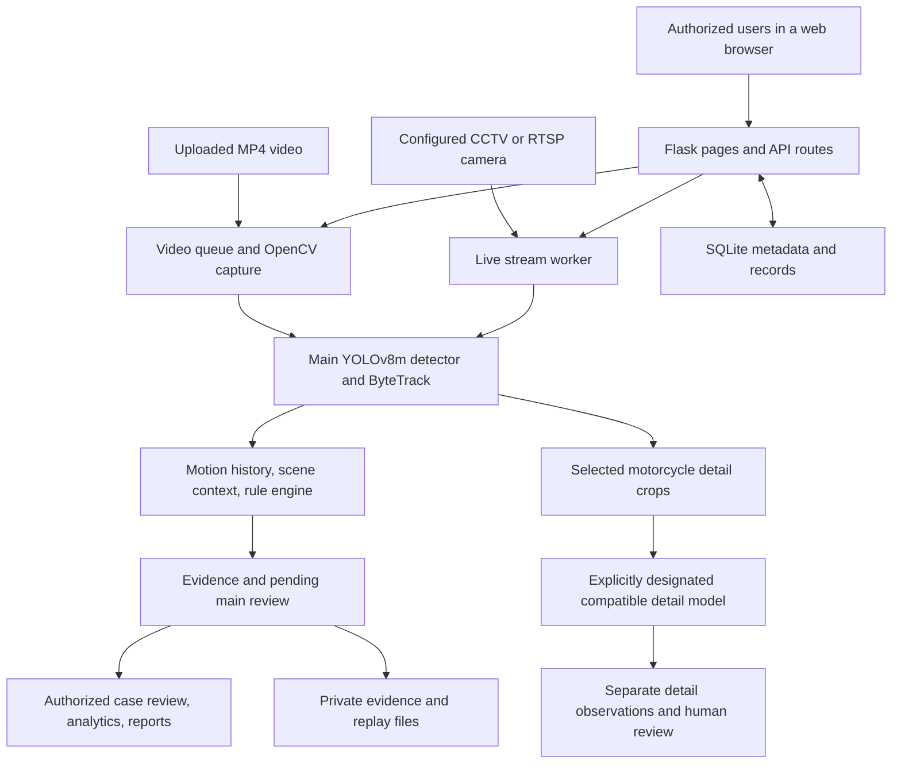
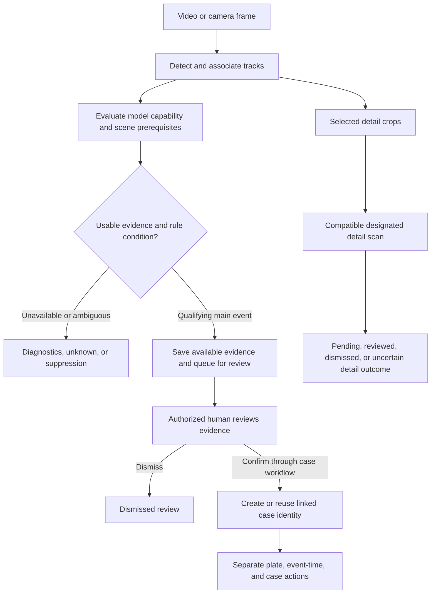

# TAVIDM
## Capstone 2 Project Update / Report Reference

**Project title:** TAVIDM: Traffic Violation Detection and Monitoring System Using Computer Vision and Deep Learning  
**Reference date:** 2 October 2026  
**Prepared for:** The TAVIDM project team  
**Document status:** Source-audited reference draft for team review

**Group members:** Mark Christian E. Osumo; Fernandez [complete name to confirm]; Parao [complete name to confirm]. Confirm the full official names, ordering, course, and section before submission. The supplied list repeats Osumo, so no additional member has been inferred.

This expanded reference follows the section coverage of the supplied GURO report: project background and modules, technology and algorithms, completion, detailed feature status, datasets, and supporting figures. GURO is a formatting reference only; its technology, percentages, participant counts, institutional clearances, and results are not TAVIDM evidence.

**How to use this document.** Sections 1-6 provide report-ready material. Sections 7-9 provide diagrams, evidence requirements, and speaking notes. Before submission, complete the member details, approve a milestone-based completion percentage, and insert current application screenshots. Technical evidence comes from the local working copy at `D:\tavidm`, including uncommitted work.

## 1. Project Description

### A. Problem background

Traffic monitoring requires personnel to observe road activity, identify relevant events, inspect evidence, and organize records. Reviewing video manually becomes time-consuming when footage contains many vehicles, overlapping road users, and events spread over time. A single image can also be misleading: a stationary vehicle may be temporarily stopped, a rider's helmet may be hidden, or a vehicle may appear inside a restricted area without sufficient context to establish a violation.

TAVIDM addresses this workflow by combining visual detection, tracking, configured road geometry, temporal rules, and human review. It helps operators locate possible events and retain evidence for assessment. These statements describe the project's problem and design purpose; the audit did not measure reductions in review time or prove improvements in traffic safety.

### B. System purpose and scope

TAVIDM is an AI-assisted traffic monitoring web application designed to process uploaded road videos and support live CCTV streams. Its main detector identifies observable vehicles, persons, riders, helmets, and side mirrors. Tracking associates observations across frames, while the rule engine evaluates movement, stationary duration, rider associations, road zones, configured schedules, and supported scene annotations.

The application connects this processing pipeline to a dashboard, live monitor, evidence review, violation records, case review, analytics, reports, and administration. Suspected events from the main pipeline are placed in a review queue. Authorized users can inspect evidence and confirm or dismiss a review item; case actions and identity verification are handled separately. The system assists decision-making rather than establishing offender identity from a detector output alone.

### C. Intended users

- **System Administrator:** manages users, camera records, system settings, and configuration, with administrative access to application functions.
- **Traffic Enforcement Officer:** reviews suspected events, manages authorized case actions, verifies readable plate identities, and accesses reporting functions.
- **Guest Viewer:** uses permitted read-only dashboards, monitoring views, violation listings, and analytics.

These are implemented account roles. The audit did not establish a completed field deployment with a named traffic authority or an approved research respondent sample.

<!-- pagebreak -->

## 2. Core System Modules

### A. Video ingestion and scene annotation

The upload workflow accepts MP4 video files, stores their metadata, and provides frame access for annotation. Operators can configure road regions and reusable zone templates. The current registry contains six zone types: no parking, active lane, pedestrian crossing, truck-ban zone, loading/unloading, and restricted lane. Structured scene annotations also support lane flow, marking geometry, and applicable sign context.

The default upload limit is 3,072 MB. That is a configured application limit; a maximum-size upload through a deployed server/proxy was not tested in this audit. Annotation supplies contextual meaning that a detector cannot obtain merely by recognizing a vehicle.

### B. Detection, tracking, and background processing

The main pipeline uses YOLOv8m and ByteTrack. OpenCV reads video frames, and tracking history supplies centroids, displacement, direction, and stationary duration. Uploaded jobs run through an in-process background queue with progress, cancellation, processing history, and annotated replay support. The UI can track an active attempt while retaining the identity of an earlier completed result.

Live CCTV processing uses camera stream workers and exposes annotated frames through the monitoring view. Stream-processing code is present; the audit did not connect to and exercise a real RTSP camera. The uploaded-video queue is thread based, not an independently deployed distributed worker service.

### C. Violation evaluation and evidence

The rule engine retains twelve canonical violation categories. It evaluates object associations and scene context over time rather than treating all violations as direct YOLO classes. Capability checks determine whether required model labels and contextual prerequisites are available. Evidence includes still images, vehicle crops, event metadata, confidence factors, and uploaded-video temporal evidence where available.

The temporal evidence implementation supports pre-event context and post-event context, with defaults of three seconds before confirmation and three seconds after an episode ends. Actual coverage depends on source boundaries and successful evidence finalization; not every event is guaranteed a complete clip.

### D. Human review and case management

The main review queue supports confirmation and dismissal. Case services retain linked observations and support plate verification, event-time review, policy records, case confirmation, and print-related actions. Authentication determines the actor performing a review; a client-supplied reviewer identifier does not establish authority.

The motorcycle-detail review workflow is separate. It collects selected crops, scans them with an explicitly designated compatible detail checkpoint, and records observations for human review. It never creates or confirms violations or cases.

### E. Analytics, reports, and administration

The application includes dashboards, analytics, vehicle crossing summaries, filtered violation listings, and PDF/Excel reports. Administrative routes manage users, cameras, settings, and templates. Reports summarize stored application records; they do not independently certify the accuracy or legal sufficiency of those records.

<!-- pagebreak -->

## 3. AI/ML Models and Key Technologies

### A. Main object detector: YOLOv8m

The main model family is YOLOv8m, accessed through Ultralytics. The weight resolver prefers local custom checkpoints in this order: `tavidm_yolov8m.pt`, `best.pt`, then `yolov8m_custom.pt`. A pretrained YOLOv8m checkpoint is the development fallback when these files are absent.

During the audit, the resolver selected `models/tavidm_yolov8m.pt`. Loading its metadata exposed the canonical ordered fifteen-class object roster. The separate `models/best.pt` file exposed an older seven-class roster. This establishes local availability and class compatibility; it does not establish which weights a separately running server currently holds or prove acceptable field accuracy.

**Ten vehicle labels:** car, van, jeepney, tricycle, autorickshaw, bus, truck, pickup_truck, motorcycle, and bicycle.

**Five additional object/attribute labels:** person, rider, helmet_acceptable, helmet_nut_shell, and side_mirror.

The training specification also contains nine scene labels, for twenty-four specified labels overall. Those nine scene labels are not part of the inspected fifteen-class checkpoint. Twelve violation categories are a separate rule-engine roster.

### B. Multi-object tracking: ByteTrack

ByteTrack associates detections over time. TAVIDM stores motion history for each track and uses it in trajectory, stationary-duration, and direction checks. A track ID is a processing identifier; it is not a vehicle registration, persistent cross-camera identity, or verified offender identity. Occlusion and track fragmentation can affect downstream counts and events.

### C. Experimental motorcycle-detail detector: YOLOv8n

Local detail-training records describe a separate YOLOv8n model for `helmet_nut_shell`, `helmet_acceptable`, and `side_mirror`. The application supports this ordered three-class contract and a separate four-class contract adding a positive `no_helmet` observation. Four-class contract support does not establish that a four-class model has been trained or activated.

No detail designation was found in the inspected `.env`, the audit process environment, or local database settings. A running server could have different environment settings. Detail inference activation therefore remains unverified. The secondary model does not replace the main detector or send detections into its tracking/rule pipeline.

### D. Application and data technology

| Layer | Technology | Role in TAVIDM |
| --- | --- | --- |
| Detection and tracking | Ultralytics YOLOv8m, ByteTrack | Main object observations and frame-to-frame association |
| Secondary detail analysis | Experimental YOLOv8n | Helmet/mirror observations for separate review |
| Video and geometry | OpenCV, NumPy, Python helpers | Frame capture, annotation, motion, ROI, and evidence processing |
| Application server | Python and Flask | Server-rendered pages, API routes, authentication, and job orchestration |
| Interface | Bootstrap, JavaScript, HTML templates | Monitoring, annotation, review, analytics, and administration |
| Persistence | SQLite | Users, video metadata, detections, processing runs, reviews, cases, and settings |
| Reports | fpdf2 and openpyxl | PDF and Excel exports |
| Plate-processing preparation | FastALPR-compatible injected adapter | Machine candidate contract; real automatic backend still deferred |

CCTV/RTSP is the camera input mechanism. Dedicated IoT sensors, custom embedded hardware, cloud model serving, and a mobile application were not established as implemented features in this audit.

<!-- pagebreak -->

## 4. Algorithms and Decision Logic

### A. Image-space movement and stationary duration

For a tracked bounding box, the tracker stores its center across timestamps. Movement speed is calculated from the displacement between the first and last observations in a recent time window:

**Image-space speed = sqrt((x1 - x0)^2 + (y1 - y0)^2) / (t1 - t0), in pixels per second.**

When there is sufficient movement, direction is calculated as **atan2(y1 - y0, x1 - x0)** and converted to degrees modulo 360. In image coordinates, zero degrees points right and ninety degrees points down. Insufficient history or displacement does not supply a valid heading.

Stationary duration accumulates while image-space speed stays within the configured threshold and resets when movement resumes. These calculations support dwell and counterflow checks. They do not provide calibrated road speed in km/h; speeding enforcement is not claimed.

### B. Regions of interest, lane direction, and schedules

Operators supply polygons and other scene geometry. Rules combine zone membership with conditions such as stationary duration, lane heading, or a truck-ban schedule. Counterflow can use per-lane flow directions and suppress ambiguous or unavailable lane context. Truck-ban evaluation needs the applicable vehicle class, zone, and usable recording date/time.

Current default tuning includes thirty seconds for the parking dwell proxy, ten seconds for active-lane obstruction, and three seconds for pedestrian-crossing blockage. These are configurable implementation values, not independently validated legal thresholds. The guide does not assert that these defaults match every site or ordinance.

### C. Vehicle passage counting

The crossing counter uses the bottom-center of a vehicle box as its reference point. It evaluates signed distance from an operator-defined line and counts a qualifying transition from one side to the other. A small hysteresis band reduces repeated flips near the line. Each line/track pair is counted at most once per processing run, and configured direction can restrict accepted transitions.

Only the ten canonical vehicle classes contribute. Persons, riders, helmets, and side mirrors are excluded. With several lines, a vehicle can contribute once at each line, so aggregate passages are not necessarily globally unique vehicles. Missing counting-line geometry produces unavailable counts rather than proof that no vehicles passed.

### D. Rule confidence and capability checks

Detector confidence and violation confidence are stored separately. The scoring helper combines available persistence, geometry, association, context, and detection-reliability factors using weights. Missing factors remain recorded as unavailable; a confidence value is not a substitute for missing evidence.

Current confidence bands are: **95% and above**, automatically queued for operator validation; **80% to below 95%**, careful review; **below 80%**, low-confidence review/monitoring. These are review-routing bands, not automatic case-confirmation thresholds or measured accuracy guarantees.

### E. Human review and identity

A main-pipeline event becomes a review item with available evidence and reasoning. An authorized human reviews it before case actions. Plate text must be verified through the separate identity workflow. A FastALPR-compatible adapter exists, but real automatic OCR is not wired into the inspected main video/live processing paths. An OCR candidate, an unclear plate, and a verified readable plate are distinct states.

<!-- pagebreak -->

## 5. Current Completion and Project Status

### A. Overall completion percentage

**Proposed overall completion: approximately 65%.** This is an audit estimate for team discussion, not an approved team percentage or an application-generated metric. The correct final percentage should follow the team's adviser-approved requirements and milestones.

The estimate recognizes substantial application development while assigning remaining work to model validation, incomplete rule behavior, OCR integration, field demonstrations, and operational evidence. It should not be described as “65% accurate.”

| Component | Proposed weight | Estimated progress | Weighted contribution |
| --- | --- | --- | --- |
| Application, interface, and data workflows | 35% | 85% | 29.75 percentage points |
| Main detection, tracking, and model work | 25% | 65% | 16.25 percentage points |
| Complete canonical violation behavior | 25% | 50% | 12.50 percentage points |
| Field validation and operational readiness | 15% | 35% | 5.25 percentage points |
| Total | 100% | Judgment-based estimate | 63.75%, rounded to about 65% |

Both the weights and component estimates are proposed judgments. Counting five core rules out of twelve is not a complete measure of project progress. Passing focused tests also does not make every subsystem 100% complete.

### B. How to interpret status labels

- **Implemented in code:** relevant routes and processing logic exist in the inspected working copy. Field operation is a separate claim.
- **Core rule with prerequisites:** listed in the implemented-rule registry, but needs suitable model labels, configuration, context, and evidence.
- **Partial:** executable or review-oriented logic exists, but the registry does not classify the complete intended behavior as production-complete.
- **Experimental or prepared:** dataset, training record, adapter, or contract exists; integration and acceptance remain distinct milestones.
- **Not established:** the audit did not find sufficient evidence to claim implementation or validation.

### C. General project stage

**Advanced prototype: integration, model improvement, and validation remain active.** The current local checkpoint carries the full object roster, and application features connect ingestion, processing, evidence, review, and reporting. Completion still requires representative field evidence and decisions around partial behavior.

Neither “all twelve violations are fully operational” nor “only model training remains” accurately summarizes the inspected system. Documentation and readiness flags contain older statements; actual training logs, source behavior, and current configuration must be reconciled before formal submission.

<!-- pagebreak -->

## 5.1 Features Implemented in the Current Code

The following **report reference IDs are created for this document**. They are not official requirement IDs from an approved manuscript. Match them to your actual FR numbering before submission.

- **REF-01 - Role-based authentication.** Login uses bcrypt password verification, and authenticated requests recheck the current database user and session stamp. Administrator, enforcer, and viewer roles have different permissions.
- **REF-02 - Uploaded-video management.** MP4 ingestion, stored metadata, frame access, media access, result removal, and video removal routes are present.
- **REF-03 - Scene annotation and templates.** Operators can create, edit, duplicate, and apply templates; structured annotations retain supported scene context.
- **REF-04 - Background job management.** Individual and bulk processing routes expose queue state, progress, cancellation, preview, and job listings.
- **REF-05 - Main inference and tracking.** The uploaded-video and live pipelines use the Detector wrapper, ByteTrack association, motion history, and rule evaluation.
- **REF-06 - Capability diagnostics.** The code checks class-roster compatibility and per-rule prerequisites and records reasons when evaluation is unavailable.
- **REF-07 - Evidence capture.** Main events can retain stills, vehicle crops, timestamps, confidence factors, and temporal evidence. Actual evidence availability remains visible to reviewers.
- **REF-08 - Review queue.** Authorized reviewers can inspect pending events and confirm or dismiss them. Main detections do not directly create an accepted case identity.
- **REF-09 - Case review.** Routes and services support case retrieval, human plate verification, event-time review, case actions, policy linkage, and printable records.
- **REF-10 - Vehicle crossing summaries.** Run-local line-crossing totals and class breakdowns are persisted and presented using the current completed result identity.
- **REF-11 - Dashboard and analytics.** Server-rendered dashboard and analytics pages expose application summaries and stored results.
- **REF-12 - Report generation.** Filtered report creation, listing, and authenticated PDF/Excel download routes are present.
- **REF-13 - Camera management and stream support.** Camera creation, updates, stream display, status, and stop routes connect to live workers. A real camera demonstration remains outstanding in this audit.
- **REF-14 - Processing history and replay.** Processing-run identity, stored history, and annotated replay distinguish completed results from subsequent attempts.
- **REF-15 - Motorcycle-detail review workflow.** Candidate selection, compatible checkpoint contracts, bounded scan/retry behavior, evidence display, and human review outcomes exist. Real checkpoint designation and activation were not established.

**Verification boundary:** 334 focused tests passed in the preceding audit. They cover selected label/rule contracts, detail-review behavior, plate adapter behavior, and crossing logic. They do not establish successful manual use of every feature listed here. The test suite was not rerun merely to expand this document; these are the recorded audit results from this conversation.

<!-- pagebreak -->

## 5.2 Status of All Twelve Canonical Violations

The registry contains five core rules and seven partial rules. No canonical category remains solely in the planned-rule tuple, but that does not make every evaluator complete or field validated.

| Canonical category | Current classification | Meaning and remaining boundary |
| --- | --- | --- |
| Illegal Parking | Partial | Stationary dwell in a no-parking region produces a parking proxy for review; stopping alone is insufficient proof. |
| Obstruction | Core rule | Uses configured active-lane/crossing regions and sustained stationary behavior; geometry and dwell settings matter. |
| Counterflow | Core rule | Compares movement with lane flow, requires motion history, and suppresses unavailable or conflicting lane context. |
| Truck-Ban Violation | Core rule | Needs applicable vehicle classes, a truck-ban zone, configured schedule, and usable recording time. |
| No Helmet | Core, model dependent | Requires motorcycle/rider associations, helmet-class capability, observability, and persistence; missing detections alone are insufficient. |
| No Side Mirror | Partial; manual review | Requires observable mounting areas and multi-frame evidence; missing detections cannot establish absence. |
| Motorcycle Overloading | Core rule | Current logic evaluates more than two associated riders over time; occlusion and attribution affect reliability. |
| Disregarding Traffic Sign | Partial | Configured no-entry behavior has executable logic; other sign types remain unsupported/review-only in this release. |
| Failure to Follow Road/Pavement Markings | Partial | Uses saved marking geometry and temporal movement context; the general category is not production-complete. |
| Illegal Terminal | Partial | Uses public-utility context, activity geometry, and passenger activity for review; van for-hire status remains contextual. |
| Unauthorized Passenger in Applicable Truck/Pickup Cargo Area | Partial | Requires applicable class, person/cargo-area attribution, and visibility/context; broad person overlap is insufficient. |
| Substandard / Nut-Shell Helmet | Partial; model dependent | Requires helmet taxonomy, rider association, and observable evidence; final category remains subject to review. |

The default enabled-rule set contains the five core rules. Current saved settings and capability checks can affect execution. Do not infer that every rule is enabled simply because its name appears in the UI or registry.

The main pipeline places emitted events into human review. The separate detail scanner may record helmet/mirror observations, including positive uncovered-head observations under a compatible four-class contract, but cannot create or confirm any category above.

<!-- pagebreak -->

## 5.3 Work Still Needed and Future Scope

### A. Current development and validation milestones

1. **Main-model acceptance.** Verify the selected checkpoint's provenance and evaluation results, then assess per-class precision/recall, small objects, occlusions, lighting, and camera viewpoints. A correct fifteen-class roster is necessary but does not establish quality.
2. **Weak-class improvement.** Review motorcycle-detail performance, particularly nutshell helmets and mirrors. Improve reviewed training/evaluation coverage and compare candidates using the same evaluation conditions.
3. **Detail model integration.** Explicitly designate a compatible checkpoint and demonstrate crop scanning, saved evidence, retry/recovery, and human outcomes. Keep all outputs separate from automatic violation and case creation.
4. **Partial violation completion.** Resolve evidence, contextual inputs, and intended behavior for parking, terminal activity, markings, signs, cargo passengers, helmet taxonomy, and mirrors. Validate against reviewed positive and negative examples.
5. **Plate OCR integration.** Configure an approved local real backend, connect the candidate-processing workflow, evaluate readable and unreadable plates, and retain human verification before accepting identity. The existing adapter and verification UI are preparatory parts, not proof of automatic OCR completion.
6. **Unseen-location evaluation.** Use genuinely unseen Gold v3 material after model choices are frozen. Existing development, validation, and test derivatives are not substitutes for that final evaluation.
7. **End-to-end demonstration.** Demonstrate upload, annotation, processing, counting, evidence, review, case actions, analytics, and report output using representative real videos. Exercise live streams separately.
8. **Operational reliability.** Test representative workload, restart/recovery, database contention, disk usage, GPU scheduling, and realistic upload limits. The audit has no current end-to-end FPS or stress evidence sufficient for worst-case claims.

These are outstanding milestones derived from the audit. They do not assert that every item is currently being actively implemented by a teammate.

### B. Not established as implemented

The audit did not establish calibrated speeding enforcement, automated collision/incident classification, global cross-camera vehicle identification, autonomous plate-based offender identification, multi-server distributed processing, a dedicated mobile client, or custom IoT hardware.

Vehicle collision remains separate future incident scope rather than a thirteenth canonical traffic violation. Future infrastructure changes should be discussed as proposals, not reported as features already completed.

### C. Research and user evaluation

No verified TAVIDM UAT respondent count, survey results, institutional clearance identifier, or field acceptance score was established. If the team has these records outside the repository, add their actual source, sample size, dates, and results. Do not copy GURO's participants, evaluation percentages, or field status into this project report.

<!-- pagebreak -->

## 6. Data/Dataset Details

### A. Sources and provenance

The inspected main derivative combines Roboflow-exported staging/development packages with reannotated and new-location road footage. Its manifest names class-specific staging sources for autorickshaw, bicycle, bus/van, helmets, pickup trucks, tricycles, and trucks, plus a development-review source. Supplemental bus/weak-class packages and close-up material are also recorded.

The manifest records **100 included images** from the v1 reannotation package and **465 included images** from the new-location package. Named added groups include elevated-road material (45), EDSA (30), broadcast CCTV (15), intersection CCTV (10), KCC pastoral (144), Putik (171), and IBT footbridge (150). These are additions within the main dataset, not extra quantities to add to its total. A source-group name documents provenance labeling; it does not independently establish permission or license clearance.

Some supplementary origins and licenses remain unresolved. The local registry also lists TT100K, BDD100K, IDD, and Mapillary Vistas as candidate/link-only sources. Their listing does not establish acquisition or actual use in the inspected training dataset.

### B. Data types and annotation format

- **Traffic video/frame data:** road scenes and selected images used for training, development, and application processing.
- **YOLO bounding boxes:** class index and normalized center/width/height coordinates for visible objects and attributes.
- **Scene context:** operator polygons, lanes, directions, signs, marking geometry, and relevant recording metadata.
- **Processing records:** run IDs, frame observations, track IDs, class/confidence values, crossing counts, diagnostics, and processing history.
- **Review/evidence records:** event reasoning, stills/crops, temporal evidence references, human outcomes, and case action records.

These data categories describe system inputs and outputs. Stored review events are not automatically training ground truth; they require appropriate human labeling and evaluation design.

### C. Main V9.1 derivative quantity

Dataset version: `tavidm_v9_1_trainprep_closeups_trainonly_20260927`.

| Split | Image-label pairs | Annotated objects |
| --- | --- | --- |
| Training | 6,879 | 28,907 |
| Validation | 211 | 4,706 |
| Test | 213 | 8,469 |
| Total | 7,303 | 42,082 |

The preceding audit independently counted image/label files and annotation rows per class and split; all matched the manifest. Images can contain several annotated objects. The manifest records 7,303 unique image hashes, no exact duplicates in output, and no Gold v3 inclusion; those hash claims were read rather than independently rehashed in this audit.

<!-- pagebreak -->

## 6.1 Dataset Coverage and Evaluation Results

### A. Three-class motorcycle-detail derivative

Dataset version: `tavidm_v9_1_detail_3c_plus_v2_valnutshell_20261001`.

| Split | Image-label pairs | Nut-shell boxes | Acceptable-helmet boxes | Side-mirror boxes |
| --- | --- | --- | --- | --- |
| Training | 1,575 | 1,051 | 2,377 | 2,510 |
| Validation | 219 | 13 | 663 | 533 |
| Test | 243 | 77 | 661 | 599 |
| Total | 2,037 | 1,141 | 3,701 | 3,642 |

Image/label counts were checked on disk; detail box counts are from the summary. This derivative reuses V9.1 material and adds reviewed supplemental sources. Do not combine its 2,037 images with the main dataset's 7,303 and call the sum a unique-image total. The three-class derivative removes `no_helmet` annotation rows; four-class contract support is a different milestone.

### B. Coverage limitations

The main manifest records only nine nutshell boxes in validation and twelve in test, alongside nineteen bicycle boxes in each. Such small per-class counts limit evaluation confidence. The detail derivative increases nutshell coverage to thirteen validation and seventy-seven test boxes, but validation remains small.

The manifests document close-up supplements being training-only and source grouping/deduplication measures. These measures reduce particular leakage risks; they do not prove complete semantic annotation quality, full provenance, or genuinely unseen final testing. WMSU remains reserved for Gold v3 according to the inspected documentation. Final evaluation availability was not independently established.

### C. Recorded model results

| Experiment | Recorded evidence | Interpretation |
| --- | --- | --- |
| Main YOLOv8m run02, 28 September | 20 recorded epochs; best validation mAP50 0.38167 and mAP50-95 0.22341 at epoch 15 | Development result from `results.csv`; not independently tied to the currently preferred local model file |
| Detail YOLOv8n validation-nutshell run, 1 October | 39 completed epochs; best validation mAP50-95 0.0871; test precision 0.3744, recall 0.4301, mAP50 0.3382, mAP50-95 0.1140 | Experimental detail result from `training_summary.json`; not unseen-location acceptance evidence |

These metrics were read from existing artifacts, not freshly recomputed. Detection mAP is not the proportion of all violations correctly identified. Report detection metrics separately from candidate-event precision/recall, counting error, tracking continuity, processing latency, and human-review outcomes.

The evaluation harness accepts human-reviewed genuine positives, hard negatives, and unknown/suppressed cases. Candidate precision is TP/(TP+FP); recall is TP/(TP+FN). No numerical TAVIDM violation-accuracy result was established in this audit.

<!-- pagebreak -->

## 7. Supporting System Diagrams

### Figure 1. Current TAVIDM architecture and processing responsibilities

<!-- diagram:architecture -->

**Explanation:** Flask is the application boundary for browser access and job orchestration. Main video and live-camera inputs feed the shared detector/tracking/rule architecture. Evidence and pending review connect processing to human decisions. SQLite stores structured records while private files retain media and reports. The detail branch has its own observations and human outcomes; it does not feed automatic violation or case creation.

**Source and scope:** diagram derived from `app.py`, `core/video_processor.py`, `core/live_stream.py`, `core/motorcycle_detail_scan.py`, and `database/schema.sql`, inspected for this report. It illustrates implemented responsibilities and configuration boundaries. It is not a screenshot of a verified deployment. Arrows show logical flow, not separate microservices or independently scaled servers.

**Operational note:** model/camera configuration and hardware workload affect actual execution. Detail scanning requires a designated checkpoint. The source structure does not establish simultaneous high-throughput processing or a measured real-time frame rate.

<!-- pagebreak -->

### Figure 2. Main event-review workflow and the separate detail boundary

<!-- diagram:review -->

**Explanation:** the main rule engine may produce an event only within its available evidence and contextual constraints. Its confidence band describes review priority rather than final confirmation. A reviewer inspects the saved material; confirmation uses the authorized case workflow. Case identity, human plate verification, event time, and later actions remain distinct from a raw detection.

The lower branch represents motorcycle-detail observations. Even a positive uncovered-head observation from a compatible four-class model is a human-review observation. It cannot create a main review violation or confirm a case.

**Source and scope:** `core/model_capability.py`, `core/violation_engine.py`, `core/video_processor.py`, `core/case_review_service.py`, and `core/motorcycle_detail_scan.py`. This is a source-derived explanation, not a claim that every branch was demonstrated live.

### Recommended application screenshots for final submission

Use current, authorized application captures with captions describing exactly what is visible:

1. Dashboard: summary cards and navigation, with capture date and displayed data scope.
2. Video annotation: drawn zones, lane direction, and counting-line setup for one selected video.
3. Live Monitor: processing attempt, preview, and crossing summary linked to its completed run.
4. Review Queue: a pending item showing evidence and reviewer actions.
5. Case details: human plate/event-time review states and linked evidence.
6. Motorcycle Detail Review: actual scan state and observation outcomes, including whether a checkpoint is designated.
7. Analytics and exported report: filters and the corresponding PDF/Excel output.

No application screenshots are fabricated or included in this reference. These are capture instructions for the final team report, not completed manual test evidence.

<!-- pagebreak -->

## 8. Audit Evidence and Submission Checklist

### A. Evidence collected in this conversation

- Current source, schema, rule registry, routes, configuration, and relevant dataset/training artifacts were inspected.
- Both local main checkpoint class maps were loaded. Preferred file: fifteen canonical object labels; legacy `best.pt`: seven labels.
- Main and detail image-label split counts were counted on disk. Main class-level annotation counts also matched the manifest.
- The local SQLite settings were inspected read-only for motorcycle-detail designation; no matching settings were found. The inspected `.env` and audit process also lacked a designation.
- **334 focused tests passed in 90.71 seconds** in the preceding audit, using isolated database configuration and disabled background workers. Covered files: vehicle class schema, violation roster, V9.1 roster readiness, plate processing, three-class detail behavior, and vehicle crossing counter.

Those are the existing audit results, not a new full-suite run. No application code, models, or training data were changed to produce this report. Document generation created only report-related artifacts and temporary rendering files.

### B. What was not verified

A complete test-suite run, current running-server model selection, fresh model evaluation, real browser/video demonstration, RTSP-camera test, final Gold v3 evaluation, representative worst-case concurrency, and research/UAT results were not established. The report distinguishes implemented code from demonstrated deployment behavior.

### C. Documentation discrepancies

The current schema specifies ten vehicle classes and fifteen object classes. An `AGENTS.md` paragraph still refers to a twelve-class vehicle detector. `docs/SYSTEM_TRUTH_INDEX.md` also contains an older statement that local baseline weights are not integrated, although both inspected local model files now exist. Readiness controls still contain pending flags despite actual training artifacts. These discrepancies should be reconciled before relying on those documents for progress reporting.

### D. Before submitting to the adviser

- Confirm full member names, official program/section, and required institutional formatting.
- Replace the proposed 65% with the team's approved milestone calculation, or retain its explicit provisional label.
- Match this document's REF IDs to the approved functional requirement numbering.
- Add authentic application screenshots and record the sample/video/run shown.
- Add any genuine field testing, permissions, research participation, and UAT records with their sources.
- Keep model results associated with their exact checkpoint/run and evaluation split.
- Retain outstanding OCR, partial-rule, and field-validation work in the status section.

### E. Suggested overall status sentence

“TAVIDM is an advanced AI-assisted traffic monitoring prototype with implemented application, processing, evidence, review, and reporting workflows. Its twelve canonical violation categories include five core rules with prerequisites and seven partial rules. Model acceptance, OCR integration, partial-rule completion, and representative field validation remain outstanding.”

<!-- pagebreak -->

## 9. Teammate Speaking Notes and Source Map

### A. Common presentation questions

**What does the AI actually do?** YOLO detects observable objects and attributes; ByteTrack follows them across frames. Configured rules evaluate possible violations. Humans review the evidence.

**How many classes are there?** Ten vehicle labels, fifteen total object labels in the main checkpoint, twenty-four labels in the broader object-plus-scene specification, and twelve separate violation categories. State which count you mean.

**Are all twelve violations complete?** No. Five are listed as core rules and seven as partial. Even core rules need appropriate model labels, scene context, settings, and evidence.

**Does 65% mean detection accuracy?** No. It is a proposed overall development estimate. Detection and event-level evaluation require separate metrics and ground truth.

**Does the system recognize plates automatically?** Human plate verification exists, and a compatible machine-processing adapter is prepared. Real automatic OCR integration was not established in the main pipelines.

**Is it already real time?** Live stream processing code exists. This audit did not measure real-camera end-to-end FPS, latency, or concurrency, so no guaranteed performance claim is supported.

**How large is the dataset?** The inspected main derivative has 7,303 image-label pairs and 42,082 objects. The separate detail derivative has 2,037 pairs and overlaps with main data. These are version-specific counts.

**What makes it useful?** It organizes detection, temporal context, evidence, and review in one application. Measured time savings or safety impact would require a separate study.

### B. Primary local sources

- **Application/features:** `app.py`, `config.py`, `core/auth.py`, `core/reports.py`.
- **Classes and rule status:** `config/training/class_schema.json`, `core/detection_config.py`.
- **Inference and movement:** `core/detector.py`, `core/tracker.py`, `core/video_processor.py`, `core/live_stream.py`.
- **Rules and counting:** `core/violation_engine.py`, `core/model_capability.py`, `core/rule_confidence.py`, `core/vehicle_crossing_counter.py`, `core/zone_config.py`.
- **Evidence and cases:** `core/temporal_evidence.py`, `core/case_review_service.py`, `database/schema.sql`.
- **Detail and plates:** `core/motorcycle_detail_scan.py`, `core/motorcycle_detail_contract.py`, `core/plate_processing.py`.
- **Evaluation preparation:** `core/evaluation_harness.py`; presence is not an accuracy result.
- **Main data:** `dataset/derived/tavidm_v9_1_trainprep_closeups_trainonly_20260927/manifest.json` and `data.yaml`.
- **Detail data:** `dataset/derived/tavidm_v9_1_detail_3c_plus_v2_valnutshell_20261001/summary.json` and `README.md`.
- **Main results:** `dataset/training_runs/tavidm_v9_1_coco_yolov8m_20260928_run02/results.csv`.
- **Detail results:** `dataset/training_runs/tavidm_v9_1_detail_yolov8n_20261001_valnutshell/training_summary.json`.

All source paths above are relative to `D:\tavidm`. The external sample is `C:\Users\AMD\Downloads\GURO_Oct022026.pdf`, used only to guide report structure and depth. External claims in that sample were not audited or adopted as TAVIDM facts.
